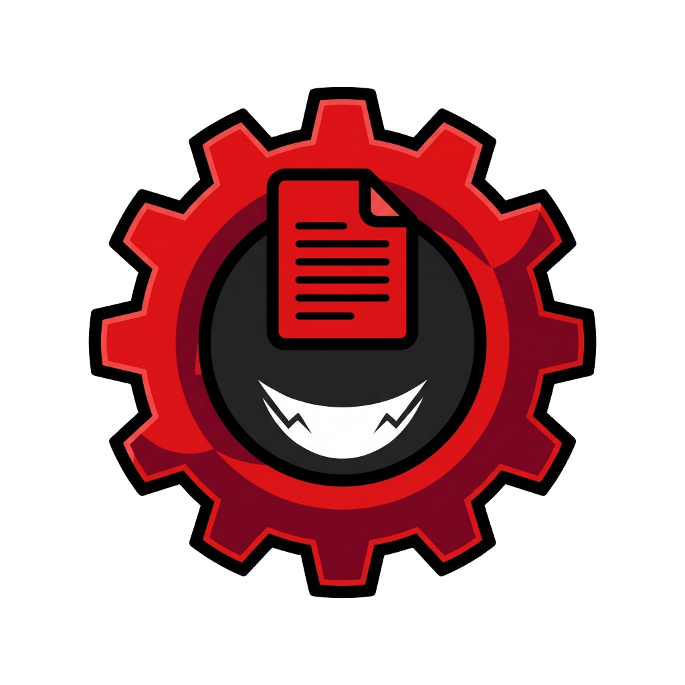

# ⚡ HardcorezForge

<p align="center">
  
</p>

<p align="center">
  <strong>The Ultimate 100% Offline, Privacy-First Mobile Office Suite for Android</strong><br>
  <em>Word Processor • Spreadsheet Calculation Engine • Slide Presentations • PDF Sign & Digital Stamps</em>
</p>

<p align="center">
  
  
  
  
  
  
</p>

<p align="center">
  <a href="release/HardcorezForge.apk?raw=true">
    
  </a>
</p>

---

## 🌟 Why HardcorezForge?

Most commercial mobile office applications require intrusive cloud logins, upload private work drafts to third-party tracking servers, bombard users with subscription banners, and fail when working in remote or offline environments.

**HardcorezForge was created on strict zero-compromise privacy principles:**
- 🛡️ **100% Offline & Private**: All document editing, spreadsheet formulas, slide previews, and PDF signatures run entirely on your local device hardware.
- ⚡ **Zero Bloat, Zero Subscriptions**: Pure, lightweight performance without telemetry, paywalls, or artificial limits.
- 📂 **Universal Storage Discovery**: Automatically locates and opens documents from internal storage, SD cards, and modern WhatsApp multi-account document folders without complex file trees.

---

## 🚀 Key Features

### 1. 📝 Document Editor (Word / Docs)
- **Rich Text Formatting**: Live toggle for bold, italic, underline, structured bullet lists, numbered lists, and header levels.
- **Real-Time Word Statistics**: Integrated counter for words, characters, and estimated reading time.
- **Native Docx & ODT Text Extraction**: Reads Microsoft Word (`.docx`) and OpenDocument (`.odt`) files directly on-device without cloud dependencies.
- **Physical Document Export**: Export documents directly to device storage as plain text (`.txt`) or Markdown (`.md`).

### 2. 📊 Spreadsheet Studio (Excel / Sheets)
- **Interactive Calculation Grid**: Smooth pan and scroll spreadsheet canvas with column letters and row indices.
- **High-Performance Formula Engine**: Computes cell expressions, mathematical operators (`+`, `-`, `*`, `/`), cell references, and statistical formulas:
  - `=SUM(A1:A10)`
  - `=AVG(B1:B5)`
  - `=COUNT(C1:C20)`
  - `=MIN(D1:D10)`
  - `=MAX(E1:E10)`
- **Native CSV & XLSX Parser**: Native Kotlin XML extraction for shared-string `.xlsx` spreadsheets and delimited tabular data (`.csv`, `.tsv`).
- **Real CSV Export**: Exports spreadsheets directly to physical `.csv` files in the device `Documents` folder for easy sharing and opening in external spreadsheet tools.

### 3. 📽️ Presentation Studio (PowerPoint / Slides)
- **Visual Deck Designer**: Build, reorder, and polish presentation slides with custom titles, bullet points, and speaker notes.
- **Dynamic Theming**: Curated slide color palettes and typography treatments.
- **Fullscreen Presentation Mode**: Distraction-free mobile slide player with smooth swipe gestures.

### 4. ✍️ PDF Reader & Native Digital Signature Studio
- **Hardware-Accelerated PDF Viewer**: Powered by Android's native `PdfRenderer` for sharp, zero-lag page navigation and crisp rendering.
- **Custom Signature Pad**: Draw smooth digital signatures with variable stroke width, undo, and quick-save.
- **Official Stamp Badges**: Quick-apply pre-configured stamp marks (*Approved*, *Paid*, *Confidential*, *Verified*).
- **Physical Signature Burning**:
  - Permanently embeds and burns drawn signatures, stamps, and dates directly into the PDF pages using Android's native `android.graphics.pdf.PdfDocument` and canvas rendering.
  - Offers smart save options: **Replace Original File** or **Save as New File** (`[original]_signed.pdf`).
- **Android FileProvider Sharing**: Share and open physical files safely using secure `content://` URIs.

### 5. 📂 Universal Device Document Scanner
- **Automatic Storage Discovery**: Automatically scans Download, Documents, Telegram, and external folders.
- **WhatsApp Multi-Account Support**: Dynamically detects document directories across WhatsApp personal, WhatsApp Business, and Android multi-account storage trees.
- **Quick Search & Filtering**: Instant search across filenames and filter chips for Word, Sheets, Slides, and PDF.

---

## 🏗️ Architecture & Native Integration

- **Frontend**: Flutter (Dart 3.x) with Material 3 responsive layout and design hierarchy.
- **Native Android Engine**: Custom Kotlin `MethodChannel` handler for:
  - High-performance PDF rendering (`PdfRenderer`).
  - Native physical PDF signature burning using Android graphics canvas.
  - Native ZIP/XML parsing for `.docx` and `.xlsx` without bulky third-party SDK dependencies.
  - Secure Android `FileProvider` (`androidx.core.content.FileProvider`) for sharing and opening files.
- **Persistence**: Local document state and physical storage access via `path_provider`.

---

## 📁 Project Structure

```text
lib/
├── core/
│   ├── models/         # Document data models and JSON serialization
│   ├── theme/          # AppTheme palette, typography, and dark/light modes
│   └── utils/          # Platform channels (PDF renderer, XLSX/DOCX parser, native sharing)
├── data/
│   ├── device_document_scanner.dart  # Multi-directory auto document scanner
│   └── document_repository.dart      # Local document persistence
├── features/
│   ├── home/           # Main hub, quick action cards, and document browser
│   ├── markdown/       # Markdown reader with instant rendering
│   ├── pdf_tools/      # PDF viewer, physical signature burning, and save options
│   ├── presentation/   # Slide presentation editor and player
│   ├── signature/      # Signature drawing canvas and stamp tool
│   ├── splash/         # Animated startup splash screen
│   ├── spreadsheet/    # Grid view, formula bar, engine, and CSV export
│   └── word_editor/    # Rich document text editor with physical export
└── main.dart           # App entry point
```

---

## 🛠️ Getting Started

### Prerequisites
- [Flutter SDK](https://docs.flutter.dev/get-started/install) (v3.19 or later)
- Android SDK (API Level 21+)

### Installation & Run

1. Clone the repository:
   ```bash
   git clone https://github.com/Zettt416/HardcorezForge.git
   cd HardcorezForge
   ```

2. Get dependencies:
   ```bash
   flutter pub get
   ```

3. Run automated tests:
   ```bash
   flutter test
   ```

4. Run on a connected device:
   ```bash
   flutter run
   ```

5. Build production release APK:
   ```bash
   flutter build apk --release
   ```
   The compiled production APK will be at `release/HardcorezForge.apk` and `build/app/outputs/flutter-apk/app-release.apk`.


---

## 📄 License

This project is open-source and available under the [MIT License](LICENSE).
